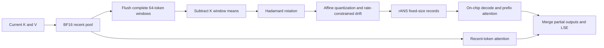

# D-Quant on Ascend

This branch contains the current single-stream implementation: one K stream
and one V stream per token, full-attention layer, and tensor-parallel rank.
It includes the round-7 quantizer and round-6 native attention implementation.

## Runtime

The integration targets vLLM 0.30.0 and model runner V1. This branch is based
on vLLM Ascend `v0.30.0` (`c09d3e20b9c45c80b34ae3781440d90904a44023`).
The previously validated runtime uses vLLM commit
`ced6857afa0ea7b2e3f0846a62e1394e90f15607` and the image
`dquant-gpqa-env:20261028_124632`, with CANN 9.1.0 on Ascend 910B3.
The named image is a local validation image, not a public dependency.
The integration changes here adapt the installed implementation to this branch's
framework baseline; the production checkout is left untouched.

The measured configuration uses Qwen3.8-27B with BF16 weights and TP2:
12 query heads, two KV heads, and head size 256 per rank. The model has
16 full-attention layers and 48 GDN layers. Only full-attention KV is compressed.
MRV2, speculative decoding, prefix caching with window state, KV transfer,
and PP/PCP/DCP are rejected by this implementation.

## Data Path



Each rank's two KV heads are concatenated into 512-value streams. K and V
have separate scales, offsets, probability tables, and byte budgets. The
quantizer minimizes squared reconstruction error plus a rate penalty, refits
FP16 affine metadata, and reassigns symbols using the stored metadata. The
final feasible assignment is reused to reduce redundant drift work.

rANS preserves the assigned symbols exactly. Its four-byte terminal state
and emitted bytes must fit inside the payload; unused bytes are padding.
Overflow or invalid state prevents committing a record. Graph execution
records errors on device and checks them before returning sampled output.
An entropy estimate alone is not an exact byte-size guarantee.

The optional Ascend C backend decodes 64-token tiles into UB and fuses
QK/PV computation, writing only partial outputs and LSE to HBM. Live tiles
are distributed across vector cores using device-side lengths. It does not
allocate a persistent dense KV mirror or symbol cache in the measured setup.
Unsupported native shapes use the Triton backend.

## Configuration

All switches are centralized and documented in `vllm_ascend/envs.py`.
Set the following inside the worker environment before launching vLLM:

```sh
export VLLM_USE_V2_MODEL_RUNNER=0
export VLLM_ASCEND_ENABLE_DQUANT=1
export VLLM_ASCEND_DQUANT_FUSED_ATTENTION=1
export VLLM_ASCEND_DQUANT_RECENT_WINDOW=128
export VLLM_ASCEND_DQUANT_KEY_WINDOW=64
export VLLM_ASCEND_DQUANT_KEY_LEVELS=8
export VLLM_ASCEND_DQUANT_VALUE_LEVELS=6
export VLLM_ASCEND_DQUANT_KEY_BYTES=155
export VLLM_ASCEND_DQUANT_VALUE_BYTES=109
export VLLM_ASCEND_DQUANT_ALPHA=1.4
export VLLM_ASCEND_DQUANT_OUTPUT_CHUNK=64
export VLLM_ASCEND_DQUANT_FUSED_CHUNK_TOKENS=64
export VLLM_ASCEND_DQUANT_FUSED_TILE_TOKENS=64
export VLLM_ASCEND_DQUANT_MIRROR_TOKENS=0
export VLLM_ASCEND_DQUANT_HOST_MIRROR_TOKENS=0
export VLLM_ASCEND_DQUANT_SYMBOL_CACHE=0

vllm serve /path/to/model \
  --tensor-parallel-size 2 --dtype bfloat16 --block-size 128 \
  --max-model-len 135168 --max-num-seqs 32 --max-num-batched-tokens 4096 \
  --no-enable-prefix-caching --enable-chunked-prefill --language-model-only \
  --compilation-config \
  '{"cudagraph_mode":"FULL_DECODE_ONLY","cudagraph_capture_sizes":[1,2,4,8,16,32]}'
```

Adjust the model path and memory allocation for the deployment. The earlier
matched throughput measurements used a 22-GiB KV pool per rank on both paths.
`VLLM_ASCEND_DQUANT_DENSE_REFERENCE=1` selects the BF16 validation allocation;
it is not the compressed path. Older optional graph/mirror switches are kept
for compatibility and are disabled in the configuration above.

## Native Build

Source the CANN environment and build from this checkout:

```sh
cmake -S csrc/dquant -B build_dquant_native \
  -DASCEND_CANN_PACKAGE_PATH="$ASCEND_HOME_PATH" \
  -DCMAKE_BUILD_TYPE=Release -DDQUANT_BUILD_TEST_KERNELS=ON
cmake --build build_dquant_native -j4
cmake --install build_dquant_native --prefix "$PWD"
```

The runtime loads `vllm_ascend/libdquant_native.so` automatically for supported
layouts. Compiled binaries, model files, generated build directories, and
machine-specific credentials are not part of this branch.

## Validation

The source snapshot was taken on 2026-11-11. Before formatting, the installed
quantizer's SHA-256 was
`7c9e8ecadf407abc4306e2871a1bdad2898213ad7158df5204f4091385d6a18f`.
The previously installed native library's SHA-256 was
`accb5603f0fc2ba7d46d859e598fbf0130b053860b502cb5cf73f469887061b3`.
Rebuild the library locally; binary hashes can vary with toolchains and paths.

Run reference and cache integration tests in a compatible runtime:

```sh
pytest -q tests/ut/quantization/methods/test_kv_dquant.py \
  tests/ut/quantization/methods/test_dquant_drift.py \
  tests/ut/quantization/methods/test_dquant_precision_config.py \
  tests/ut/quantization/methods/test_dquant_spec.py \
  tests/ut/ops/test_dquant_allocator.py \
  tests/ut/ops/test_dquant_mamba_reservation.py \
  tests/ut/ops/test_dquant_physical_pool.py

pytest -q tests/ut/ops/test_dquant_native_state.py \
  tests/ut/ops/test_dquant_native.py tests/ut/ops/test_dquant_full_decode.py \
  tests/ut/ops/test_dquant_channel_partition.py \
  tests/ut/ops/test_dquant_drift_reuse.py tests/ut/ops/test_dquant_affine.py \
  tests/ut/ops/test_dquant_gdn_graph.py
```

Unset D-Quant window and payload overrides when checking default configuration
tests. The native state tests require the optional probe built above. Tests
cover exact integer decoding, inactive-buffer guards, page permutations,
request replacement and reordering, cache flushes, and graph replay.

Packaging validation on 2026-11-11 passed 66 reference/cache integration tests
and 55 NPU regression tests on a separate Ascend 910B3 card. The native library
and state probe were rebuilt from this branch. Formatting, static checks and
secret scanning passed. The pinned actionlint environment could not download
its Go toolchain; workflow lint passed separately with the host's cached
actionlint configuration. The checked-in hook configuration is unchanged.

The existing Mamba-manager patch must distinguish locally computed tokens from
external KV loads; otherwise tight hybrid cache pools can repeatedly preempt
active requests. This branch includes the installed correction and its
regression tests. Remove the override when upstream provides equivalent
reservation accounting. Runner changes bind request-owned recent state,
allocate compressed records separately from Mamba state, and check graph
errors. Their storage and lifetime contracts require runner integration.

## Recorded Results

At the configuration above, each token/layer/rank uses K 176 B plus V 114 B,
including affine metadata, alignment and the amortized K mean stripe. This
is 290 B for 1024 values, or 2.265625 bit/value: 7.06x smaller than the
corresponding 2048-B BF16 record. Recent KV, GDN state, model weights, workspaces,
graph pools and allocator overhead are additional. This is a record-level
ratio, not a measured whole-service memory reduction.

The latest paired throughput measurements, dated 2026-11-10, used TP2,
84 input tokens, concurrency 32, fixed output length, ignored EOS and graph
mode on a shared 910B3 host:

| Output Tokens | Single Stream Before/After (token/s) | BF16 (token/s) |
| --- | --- | --- |
| 512 | 294.41 / 289.26 | 601.91 |
| 1024 | 225.84 / 226.94 | 583.64 |

All runs completed 32/32 requests without preemption. These measurements
precede the packaging/integration changes on this branch and do not establish
its end-to-end throughput. Current single-stream GPQA has not been completed.
The latest full GPQA result, 166/198, belongs to the earlier two-stream version
and must not be attributed to this implementation. Kernel regression results
do not replace a current model-accuracy evaluation.
